<!-- Generated by `python -m generator` and refreshed daily by .github/workflows/profile.yml.
     Edit generator/content.toml (and generator/sections/) instead of this file. -->

  <a href="https://sai.geekindata.com"><picture><source media="(prefers-color-scheme: dark)" srcset="https://raw.githubusercontent.com/geekindata/geekindata/main/assets/hero-dark.svg"><source media="(prefers-color-scheme: light)" srcset="https://raw.githubusercontent.com/geekindata/geekindata/main/assets/hero-light.svg">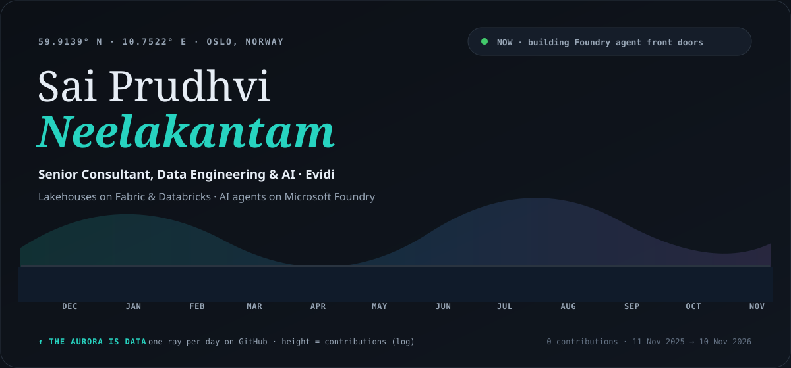</picture></a>

  <a href="https://sai.geekindata.com"><picture><source media="(prefers-color-scheme: dark)" srcset="https://raw.githubusercontent.com/geekindata/geekindata/main/assets/link-portfolio-dark.svg"><source media="(prefers-color-scheme: light)" srcset="https://raw.githubusercontent.com/geekindata/geekindata/main/assets/link-portfolio-light.svg"></picture></a>
  <a href="https://www.geekindata.com"><picture><source media="(prefers-color-scheme: dark)" srcset="https://raw.githubusercontent.com/geekindata/geekindata/main/assets/link-field-notes-dark.svg"><source media="(prefers-color-scheme: light)" srcset="https://raw.githubusercontent.com/geekindata/geekindata/main/assets/link-field-notes-light.svg"></picture></a>
  <a href="https://linkedin.com/in/saiprudhvineelakantam"><picture><source media="(prefers-color-scheme: dark)" srcset="https://raw.githubusercontent.com/geekindata/geekindata/main/assets/link-linkedin-dark.svg"><source media="(prefers-color-scheme: light)" srcset="https://raw.githubusercontent.com/geekindata/geekindata/main/assets/link-linkedin-light.svg"></picture></a>
  <a href="https://x.com/geekindata"><picture><source media="(prefers-color-scheme: dark)" srcset="https://raw.githubusercontent.com/geekindata/geekindata/main/assets/link-x-dark.svg"><source media="(prefers-color-scheme: light)" srcset="https://raw.githubusercontent.com/geekindata/geekindata/main/assets/link-x-light.svg"></picture></a>
  <a href="https://sessionize.com/saiprudhvineelakantam/"><picture><source media="(prefers-color-scheme: dark)" srcset="https://raw.githubusercontent.com/geekindata/geekindata/main/assets/link-sessionize-dark.svg"><source media="(prefers-color-scheme: light)" srcset="https://raw.githubusercontent.com/geekindata/geekindata/main/assets/link-sessionize-light.svg"></picture></a>
  <a href="mailto:sai@geekindata.com"><picture><source media="(prefers-color-scheme: dark)" srcset="https://raw.githubusercontent.com/geekindata/geekindata/main/assets/link-email-dark.svg"><source media="(prefers-color-scheme: light)" srcset="https://raw.githubusercontent.com/geekindata/geekindata/main/assets/link-email-light.svg"></picture></a>
  <a href="https://calendly.com/saiprudhvin/30min"><picture><source media="(prefers-color-scheme: dark)" srcset="https://raw.githubusercontent.com/geekindata/geekindata/main/assets/link-book-30-min-dark.svg"><source media="(prefers-color-scheme: light)" srcset="https://raw.githubusercontent.com/geekindata/geekindata/main/assets/link-book-30-min-light.svg"></picture></a>

  I build <b>lakehouse platforms</b> on Microsoft Fabric &amp; Azure Databricks and <b>enterprise AI agents</b> on Microsoft Foundry,
then write up what broke, what changed and what held up at <a href="https://www.geekindata.com">geekindata.com</a>.

  <picture><source media="(prefers-color-scheme: dark)" srcset="https://raw.githubusercontent.com/geekindata/geekindata/main/assets/h-whoami-dark.svg"><source media="(prefers-color-scheme: light)" srcset="https://raw.githubusercontent.com/geekindata/geekindata/main/assets/h-whoami-light.svg"></picture>

  <picture><source media="(prefers-color-scheme: dark)" srcset="https://raw.githubusercontent.com/geekindata/geekindata/main/assets/whoami-dark.svg"><source media="(prefers-color-scheme: light)" srcset="https://raw.githubusercontent.com/geekindata/geekindata/main/assets/whoami-light.svg"></picture>

  <picture><source media="(prefers-color-scheme: dark)" srcset="https://raw.githubusercontent.com/geekindata/geekindata/main/assets/h-telemetry-dark.svg"><source media="(prefers-color-scheme: light)" srcset="https://raw.githubusercontent.com/geekindata/geekindata/main/assets/h-telemetry-light.svg"></picture>

  <picture><source media="(prefers-color-scheme: dark)" srcset="https://raw.githubusercontent.com/geekindata/geekindata/main/assets/telemetry-dark.svg"><source media="(prefers-color-scheme: light)" srcset="https://raw.githubusercontent.com/geekindata/geekindata/main/assets/telemetry-light.svg"></picture>

  <picture><source media="(prefers-color-scheme: dark)" srcset="https://raw.githubusercontent.com/geekindata/geekindata/main/assets/h-stack-dark.svg"><source media="(prefers-color-scheme: light)" srcset="https://raw.githubusercontent.com/geekindata/geekindata/main/assets/h-stack-light.svg"></picture>

  <picture><source media="(prefers-color-scheme: dark)" srcset="https://raw.githubusercontent.com/geekindata/geekindata/main/assets/stack-dark.svg"><source media="(prefers-color-scheme: light)" srcset="https://raw.githubusercontent.com/geekindata/geekindata/main/assets/stack-light.svg"></picture>

  <picture><source media="(prefers-color-scheme: dark)" srcset="https://raw.githubusercontent.com/geekindata/geekindata/main/assets/h-work-dark.svg"><source media="(prefers-color-scheme: light)" srcset="https://raw.githubusercontent.com/geekindata/geekindata/main/assets/h-work-light.svg"></picture>

  <a href="https://sai.geekindata.com/#projects"><picture><source media="(prefers-color-scheme: dark)" srcset="https://raw.githubusercontent.com/geekindata/geekindata/main/assets/work-dark.svg"><source media="(prefers-color-scheme: light)" srcset="https://raw.githubusercontent.com/geekindata/geekindata/main/assets/work-light.svg"></picture></a>

  <picture><source media="(prefers-color-scheme: dark)" srcset="https://raw.githubusercontent.com/geekindata/geekindata/main/assets/h-stage-dark.svg"><source media="(prefers-color-scheme: light)" srcset="https://raw.githubusercontent.com/geekindata/geekindata/main/assets/h-stage-light.svg"></picture>

  <a href="https://sessionize.com/saiprudhvineelakantam/"><picture><source media="(prefers-color-scheme: dark)" srcset="https://raw.githubusercontent.com/geekindata/geekindata/main/assets/stage-dark.svg"><source media="(prefers-color-scheme: light)" srcset="https://raw.githubusercontent.com/geekindata/geekindata/main/assets/stage-light.svg"></picture></a>

  <picture><source media="(prefers-color-scheme: dark)" srcset="https://raw.githubusercontent.com/geekindata/geekindata/main/assets/h-notes-dark.svg"><source media="(prefers-color-scheme: light)" srcset="https://raw.githubusercontent.com/geekindata/geekindata/main/assets/h-notes-light.svg"></picture>

<!-- field-notes:start -->
- **[Fabric Branch Workspaces: Ready for Team Git?](https://www.geekindata.com/blog/56-fabric-branch-workspaces-ready)** 31 Oct 2026 · Branch workspaces, selective branching and compare and commit are GA in Fabric. What I tested, what is still Preview…
- **[Fabric Engines on 1B Rows: Pick by Query Shape](https://www.geekindata.com/blog/55-fabric-engines-1b-rows-query-shape)** 31 Oct 2026 · 7 queries on 1B rows in Spark, Warehouse, Direct Lake and Eventhouse. Warehouse and Spark never failed; Direct Lake…
- **[Fabric Data Agents: What a 20-Question Baseline Proves](https://www.geekindata.com/blog/54-fabric-data-agent-baseline)** 31 Oct 2026 · I baselined a Fabric data agent on 20 questions with no instructions. 19 were right. The miss was a guess it never…
- **[Fabric Mirroring Lag: Where the Minutes Go](https://www.geekindata.com/blog/53-fabric-mirroring-lag-where-it-goes)** 31 Oct 2026 · Changes reached Delta in a Fabric SQL database mirror in 18 seconds, then took about 2 minutes to show on the SQL…
- **[Foundry Hosted Agents Still Need a Front Door](https://www.geekindata.com/blog/52-foundry-hosted-agents-front-door)** 30 Oct 2026 · Hosted agents move your agent&#x27;s runtime into Foundry, not your front door. When to move off a prompt agent, and what…

→ [All 54 field notes on geekindata.com](https://www.geekindata.com) · this list refreshes daily from the RSS feed
<!-- field-notes:end -->

  <picture><source media="(prefers-color-scheme: dark)" srcset="https://raw.githubusercontent.com/geekindata/geekindata/main/assets/h-lineage-dark.svg"><source media="(prefers-color-scheme: light)" srcset="https://raw.githubusercontent.com/geekindata/geekindata/main/assets/h-lineage-light.svg"></picture>

  <picture><source media="(prefers-color-scheme: dark)" srcset="https://raw.githubusercontent.com/geekindata/geekindata/main/assets/lineage-dark.svg"><source media="(prefers-color-scheme: light)" srcset="https://raw.githubusercontent.com/geekindata/geekindata/main/assets/lineage-light.svg"></picture>

  <picture><source media="(prefers-color-scheme: dark)" srcset="https://raw.githubusercontent.com/geekindata/geekindata/main/assets/h-credentials-dark.svg"><source media="(prefers-color-scheme: light)" srcset="https://raw.githubusercontent.com/geekindata/geekindata/main/assets/h-credentials-light.svg"></picture>

  <a href="https://sai.geekindata.com/#certifications"><picture><source media="(prefers-color-scheme: dark)" srcset="https://raw.githubusercontent.com/geekindata/geekindata/main/assets/credentials-dark.svg"><source media="(prefers-color-scheme: light)" srcset="https://raw.githubusercontent.com/geekindata/geekindata/main/assets/credentials-light.svg"></picture></a>

  <picture><source media="(prefers-color-scheme: dark)" srcset="https://raw.githubusercontent.com/geekindata/geekindata/main/assets/footer-dark.svg"><source media="(prefers-color-scheme: light)" srcset="https://raw.githubusercontent.com/geekindata/geekindata/main/assets/footer-light.svg"></picture>

