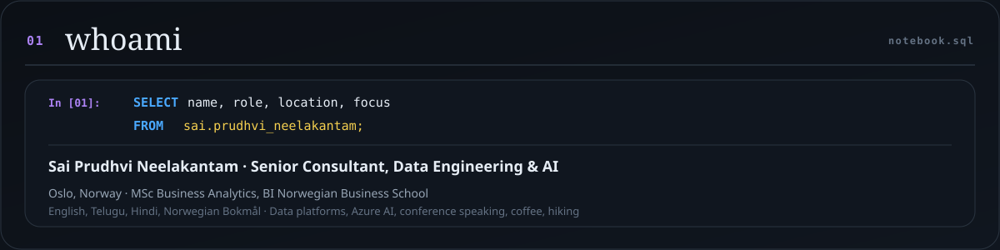
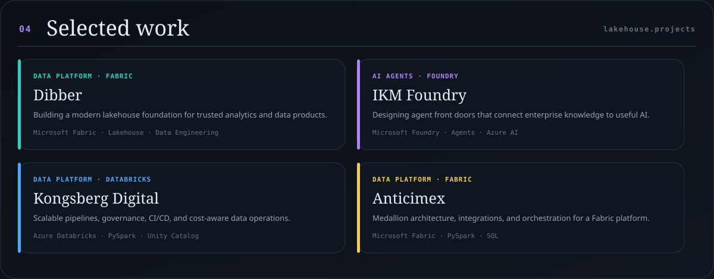
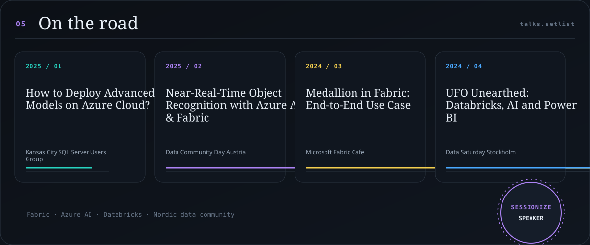
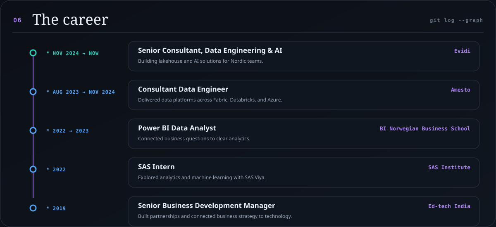
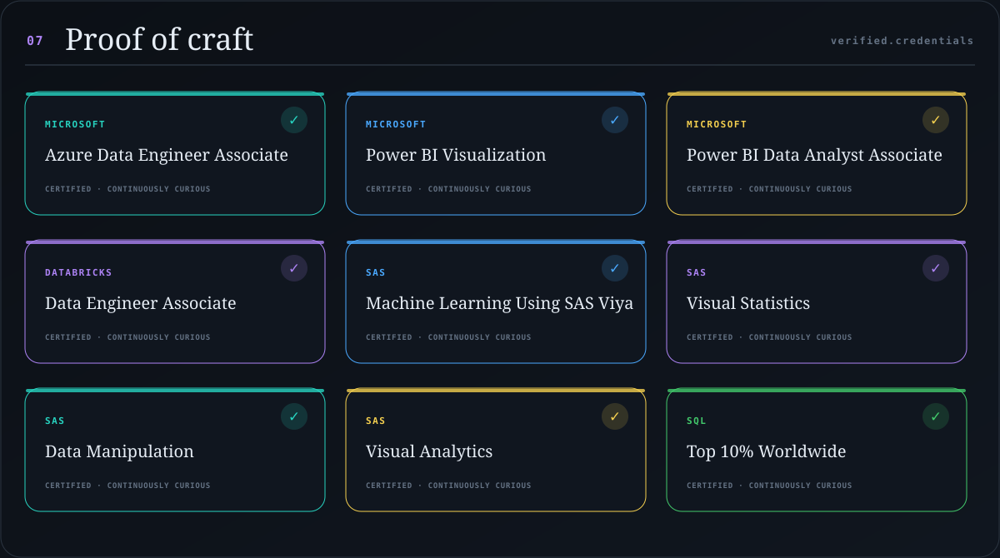

# Sai Prudhvi Neelakantam

<!-- Generated by python -m generator. Edit generator/content.toml instead. -->

<picture>
  <source media="(prefers-color-scheme: dark)" srcset="https://raw.githubusercontent.com/geekindata/geekindata/main/assets/hero-dark.svg" />
  <source media="(prefers-color-scheme: light)" srcset="https://raw.githubusercontent.com/geekindata/geekindata/main/assets/hero-light.svg" />
  
</picture>

<picture>
  <source media="(prefers-color-scheme: dark)" srcset="https://raw.githubusercontent.com/geekindata/geekindata/main/assets/whoami-dark.svg" />
  <source media="(prefers-color-scheme: light)" srcset="https://raw.githubusercontent.com/geekindata/geekindata/main/assets/whoami-light.svg" />
  
</picture>

<picture>
  <source media="(prefers-color-scheme: dark)" srcset="https://raw.githubusercontent.com/geekindata/geekindata/main/assets/telemetry-dark.svg" />
  <source media="(prefers-color-scheme: light)" srcset="https://raw.githubusercontent.com/geekindata/geekindata/main/assets/telemetry-light.svg" />
  
</picture>

<picture>
  <source media="(prefers-color-scheme: dark)" srcset="https://raw.githubusercontent.com/geekindata/geekindata/main/assets/stack-dark.svg" />
  <source media="(prefers-color-scheme: light)" srcset="https://raw.githubusercontent.com/geekindata/geekindata/main/assets/stack-light.svg" />
  
</picture>

<picture>
  <source media="(prefers-color-scheme: dark)" srcset="https://raw.githubusercontent.com/geekindata/geekindata/main/assets/projects-dark.svg" />
  <source media="(prefers-color-scheme: light)" srcset="https://raw.githubusercontent.com/geekindata/geekindata/main/assets/projects-light.svg" />
  
</picture>

<picture>
  <source media="(prefers-color-scheme: dark)" srcset="https://raw.githubusercontent.com/geekindata/geekindata/main/assets/talks-dark.svg" />
  <source media="(prefers-color-scheme: light)" srcset="https://raw.githubusercontent.com/geekindata/geekindata/main/assets/talks-light.svg" />
  
</picture>

<picture>
  <source media="(prefers-color-scheme: dark)" srcset="https://raw.githubusercontent.com/geekindata/geekindata/main/assets/career-dark.svg" />
  <source media="(prefers-color-scheme: light)" srcset="https://raw.githubusercontent.com/geekindata/geekindata/main/assets/career-light.svg" />
  
</picture>

<picture>
  <source media="(prefers-color-scheme: dark)" srcset="https://raw.githubusercontent.com/geekindata/geekindata/main/assets/certifications-dark.svg" />
  <source media="(prefers-color-scheme: light)" srcset="https://raw.githubusercontent.com/geekindata/geekindata/main/assets/certifications-light.svg" />
  
</picture>

## Field notes

_New notes will appear here when the feed is available._

---

  <a href="https://sai.geekindata.com">Portfolio</a> ·
  <a href="https://linkedin.com/in/saiprudhvineelakantam">LinkedIn</a> ·
  <a href="https://sessionize.com/saiprudhvineelakantam/">Sessionize</a> ·
  <a href="mailto:sai@geekindata.com">Email</a>

